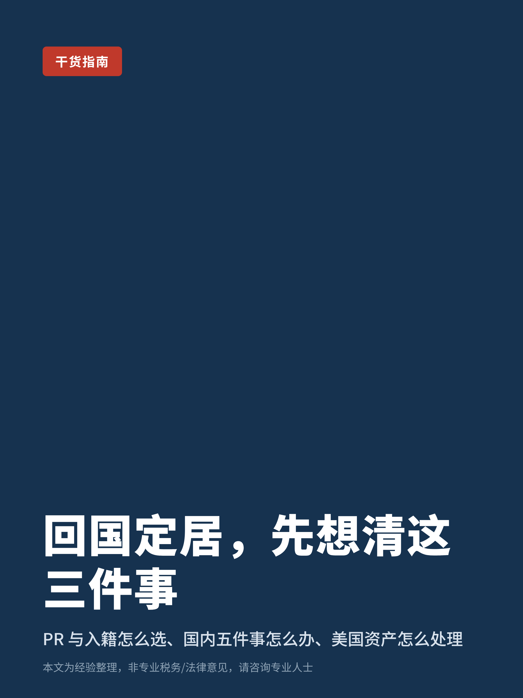
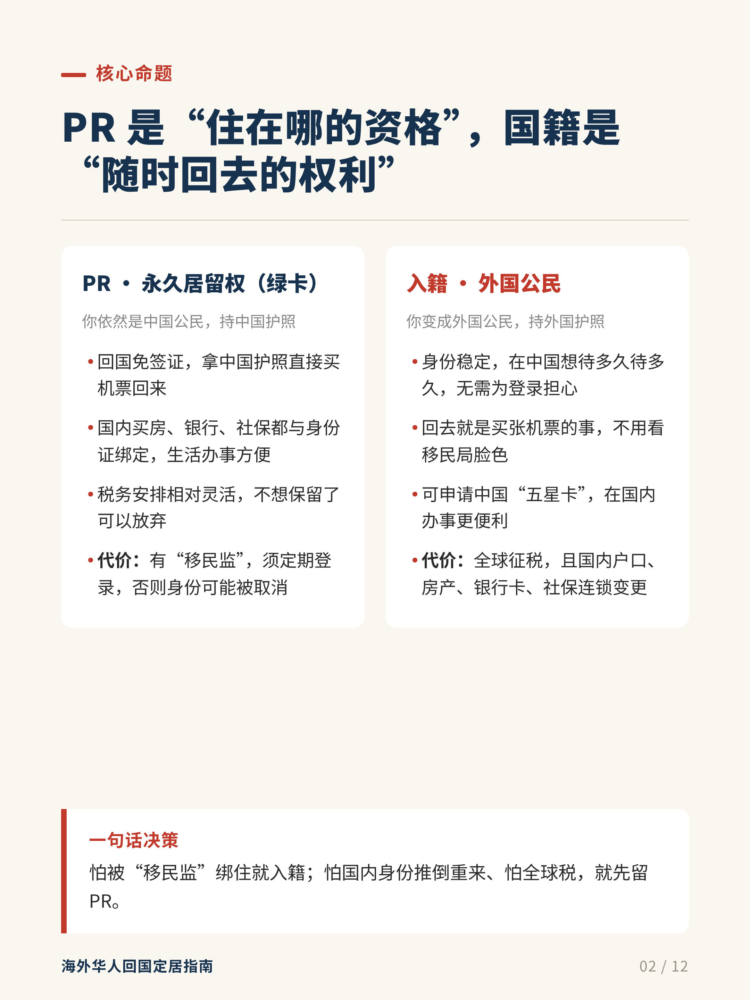
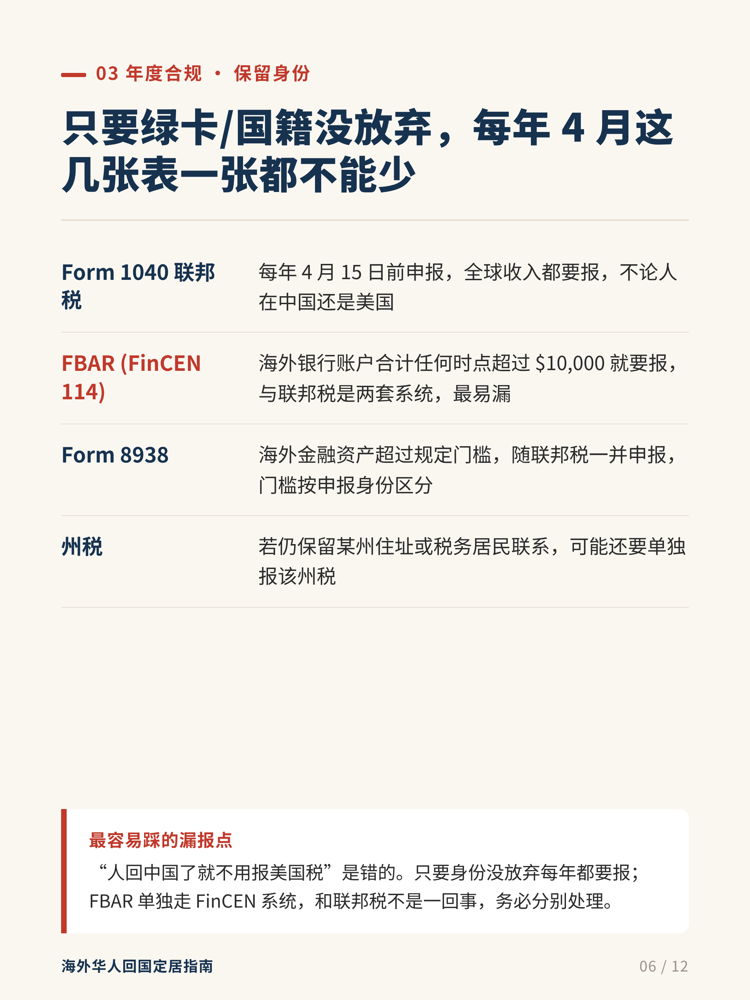
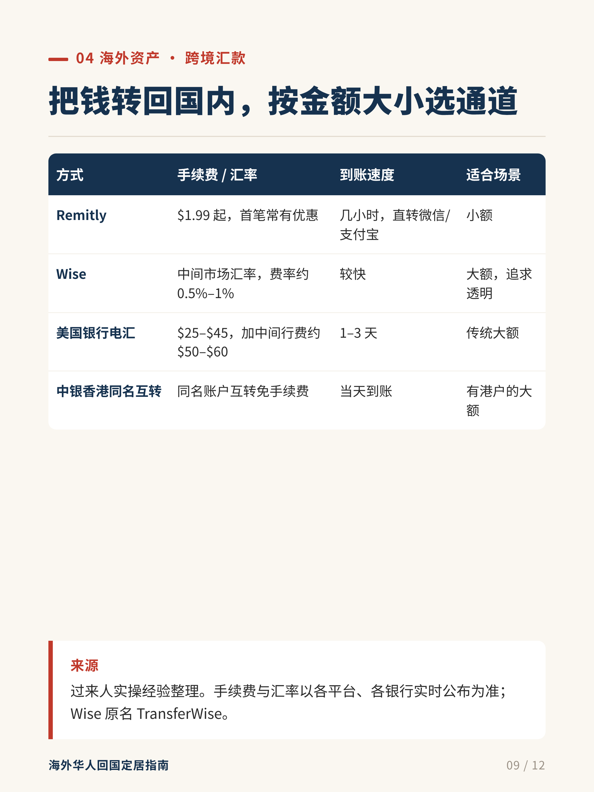

# 小红书干货图文生成器（XHS Experience Post）

把干货 / 经验 / 攻略类文字，一键批量生成**可直接发布的小红书竖版图文**。

HTML/CSS 精确排版 + Chromium 高清截图，**文字 100% 准确，零错版**——专治 AI 生图乱码、漏字、错数字。



## 一句话安装（豆包工作）

本仓库即技能本体，**已购买的用户**在豆包工作电脑版新建对话，粘贴这一句：

> 帮我安装技能：在终端运行 `npx skills add https://github.com/lcao3/xhs-experience-post`，选择 xhs-experience-post 技能并按提示完成安装。

豆包会自己打开终端完成安装（首次约 1-5 分钟，自动检测 Python 与浏览器环境，缺失会自动补齐）。装完后直接对它说：

> 帮我把这段文字做成小红书竖版图文：……

即可自动出图。

> ⚠️ 本技能为付费产品，安装即表示你已购买并接受 [LICENSE](LICENSE)（个人使用、禁止转售）。未购买请先通过下方链接获取授权。

## 为什么值得用

干货贴的核心是**文字准确、数字不出错**。AI 生图 / 改字会乱码、漏字、错数字，而本工具：

- 用 HTML 排版，字体、字号、配色、对齐完全可控
- 文字从源材料直接复制，**杜绝错版**
- 一次改数据，**批量出 12 张**统一风格的高清图
- 排版规范从小红书爆款调研沉淀，开箱即用

## 效果展示

| 双栏对比页 | 要点清单页 | 表格对比页 |
|---|---|---|
|  |  |  |

## 核心能力

- **3:4 竖版满屏**：1080×1440 CSS，导出 2160×2880 PNG，信息流占屏最大
- **爆款排版规范**：封面满版深色 + 红标签 + 金色关键词高亮；内容页米白底 + 章节标签 + 金句收尾
- **四种内容组件**：要点行、圆形数字步骤、双栏对比、深蓝表头表格，覆盖 90% 干货贴结构
- **每页只讲一个点**：信息层级清晰，收藏欲拉满
- **金句收尾**：每页底部"过来人/避坑提醒"红条框，提升收藏率
- **跨平台渲染**：Windows / macOS / Linux 自动适配，自动复用系统 Chrome/Edge

## 手动使用（不装豆包工作也行）

仓库内代码即完整版，需要本机有 Python 3.10+：

```bash
# 1. 装依赖（首次）
python3 scripts/setup.py

# 2. 改数据：编辑 build.py 里的 pages 字典（你的干货文字）
# 3. 生成页面 + 渲染高清图
python3 build.py
python3 render_all.py

# 输出在 pages/*.png（2160×2880）
```

## 适用场景

决策指南、避坑清单、流程步骤、优劣对比、参数/费用对比表、科普干货……一切"信息密度高、文字必须准确"的小红书图文。

## 如何获取授权

本仓库包含完整可运行代码；**使用授权为付费产品**（个人使用、禁止转售）。

👉 **[购买使用授权](你的购买链接在这里)**

购买后你将获得：

- 完整设计系统（base.css）与四种内容组件模板
- 跨平台渲染脚本（Windows / macOS / Linux 自动适配）
- 豆包工作一句话安装支持 + 详细使用文档
- 后续版本免费更新

## 常见问题

**Q：怎么在豆包工作里安装？**
见上文「一句话安装」。安装后豆包会自动检测并补齐 Python / 浏览器环境，你只需要说出要做的图文内容。

**Q：需要什么环境？**
豆包工作安装方式会自动处理环境；手动方式需要 Python 3.10+ 与任意 Chrome/Chromium/Edge 浏览器。

**Q：生成的内容可以商用吗？**
可以。工具生成的图文归你所有，可自由发布、商用，无需额外授权。

**Q：购买后可以转卖 / 再分发吗？**
不可以。本产品许可证为"个人使用、禁止转售"，详见 [LICENSE](LICENSE)。转售、再分发、上传公开平台均被禁止。

**Q：安装失败怎么办？**
确认豆包工作已开启"操作电脑"权限（首次使用需授权）；GitHub 访问慢时可让豆包改用 AtomGit 镜像，或在有疑问的对话里贴出报错让豆包协助排查。

## License

[个人使用许可 · 禁止转售](LICENSE)
